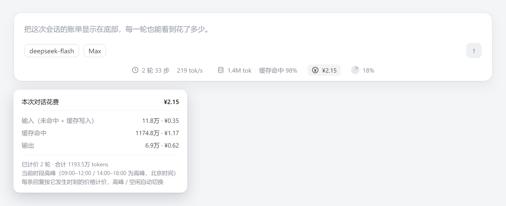
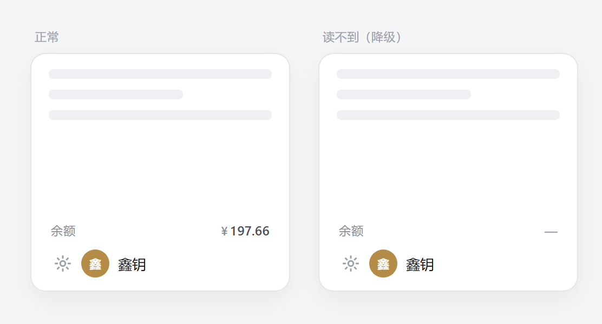

# dsh-cost-pill

**DeepSeek Harness（dsh）Web 界面插件：这次对话到底花了多少钱，随时看得见。**

[](https://github.com/xin1223yue/dsh-cost-pill/actions/workflows/verify.yml)
[](https://github.com/xin1223yue/dsh-cost-pill/releases)
[](LICENSE)



输入框下方统计行多一格 `¥2.15`，点开就是账单；每条回复的脚注行再多一个 `¥0.07`，点开是这一轮的分项；侧边栏底部再显示 DeepSeek 账户余额。

```powershell
git clone https://github.com/xin1223yue/dsh-cost-pill.git
cd dsh-cost-pill
powershell -ExecutionPolicy Bypass -File .\install.ps1   # macOS/Linux: sh ./install.sh
```

重启 dsh web → `Ctrl+Shift+R`。就这两步，没有构建、没有依赖、没有联网装包。

---

## 它显示什么

**① 统计行里的一格** —— 与「2 轮 33 步 · 219 tok/s ｜ 1.4M tok · 缓存命中 98% ｜ ◔ 6%」并排，不多占一行。

**② 每条回复脚注里的一个数** —— 就在复制 / 点赞 / `用量 2.2M tok` 那一行：


**③ 点开是账单** —— 输入（未命中 + 缓存写入）/ 缓存命中 / 输出 三行，各带 tokens 与金额，外加模型、计费时刻、当前时段、当轮单价：

```
本次对话花费                                       ¥2.15
──────────────────────────────────────────────────────────
输入（未命中 + 缓存写入）               11.8万 · ¥0.35
缓存命中                               1174.8万 · ¥1.17
输出                                     6.9万 · ¥0.62
──────────────────────────────────────────────────────────
已计价 2 轮 · 合计 1193.5万 tokens
当前时段高峰（09:00–12:00 / 14:00–18:00 为高峰，北京时间）
每条回复按它发生时刻的价格计价，高峰 / 空闲自动切换
```

弹层用的是官方「轮次用量」那套材质：半透明菜单面 + 背景虚化 + 原生投影描边，下面的输入框文字不会透上来。

**④ 侧边栏底部的余额** —— 在设置与头像上方，一行安静的 key/value：左边 `余额`（11px 三级灰），右边 `¥197.66`（12px / 500 / tabular），无边框无底色，跟侧边栏自己的文字节奏一致：



余额由 **Host 半**读取，所以登录态和 API Key 两种模式都能取：

| 顺序 | 来源 | 覆盖 |
| --- | --- | --- |
| 1 | 账号控制器 `accountController.getBalance` | 已登录 DeepSeek 账号（与设置 → 账号同源） |
| 2 | `DEEPSEEK_API_KEY`（DSH 凭据服务）→ `GET /user/balance` | 只有 API Key 的安装 |

浏览器侧不碰任何密钥，只请求插件自己的鉴权路由 `/api/cost-pill.balance`（Host 将成功结果缓存 30 秒）；页面每 60 秒刷新一次，切回页面立即补一次，遇到临时错误会在 2 秒后重试一次。两者都取不到时右侧显示 `—`，悬停说明原因。

## 为什么是它

| 关心的事 | 这个插件的做法 |
| --- | --- |
| 数字准不准 | 每轮用 provider 上报的真实桶（含缓存命中/写入）算，不按上下文长度估 |
| 高峰 / 空闲 | 按每条回复自己的 `turn/start` 时刻定档，跨 12:00 / 18:00 自动分段 |
| 换过模型 | 读 `routes[].model`，历史轮次不会被新模型价格覆盖 |
| 重开旧会话 | 已加载的轮次永远按当时的价，**不会**用今天的时段重算 |
| 估没估 | 窗口外没有逐轮记录的部分按已计价轮次的均价折算，并且**一定**带 `≈` |
| 会不会拖慢 | 纯前端读现有数据，零日志回放；余额 60 秒一次 RPC，切回页面才补一次 |
| 会不会打架 | 只往三个官方槽位各加一格，不替换任何现有控件 |
| 安装门槛 | 零依赖、零构建，仓库里就是可直接加载的 bundle |

## 安装

插件运行时零依赖、无构建步骤。安装只是两件事：把包暴露到 profile 的 `node_modules`，并把包名登记进 profile 的 `dsh.profile.bundles`。

### 方式一：克隆 + 一键脚本（推荐，不需要联网装包）

```powershell
git clone https://github.com/xin1223yue/dsh-cost-pill.git
cd dsh-cost-pill
powershell -ExecutionPolicy Bypass -File .\install.ps1
```

macOS / Linux：

```sh
git clone https://github.com/xin1223yue/dsh-cost-pill.git
cd dsh-cost-pill && sh ./install.sh
```

`install.mjs`（跨平台，三个入口都是薄包装）会：

1. 在 `~/.dsh/profiles/web/node_modules/dsh-cost-pill` 建指向克隆目录的链接（Windows 用 junction，改源码立刻生效）；
2. 把 `dsh-cost-pill` 写进 `package.json` 的 `dependencies` 与 `dsh.profile.bundles`（幂等）；
3. 打印重启提示。

参数：`--profile <名字>`（默认 `web`，也读 `$DSH_PROFILE`）、`--dry-run`（只看不改）。

### 方式二：走 dsh 的插件命令（需联网）

```sh
dsh plugin --profile web add xin1223yue/dsh-cost-pill
```

它只加依赖（转发给 pnpm），**还要手工登记 bundle**：编辑 `~/.dsh/profiles/web/package.json`，把 `"dsh-cost-pill"` 加进 `dsh.profile.bundles`。少这一步插件不会加载。

### 生效

客户端 bundle 的 revision 在 dsh 启动时烘进页面，所以装完要重启一次：

```powershell
powershell -ExecutionPolicy Bypass -File .\restart-dsh.ps1     # Windows，默认 3080
```

或手动 `Ctrl+C` 后重新 `dsh web`。重启会换新的启动令牌，用新控制台打印的 URL 打开页面；接着 `Ctrl+Shift+R` 硬刷。

### 卸载

```sh
dsh plugin --profile web remove dsh-cost-pill
```

再把 `dsh.profile.bundles` 里的那一行删掉，重启。

## 精确度

| 数据 | 来源 | 精确度 |
| --- | --- | --- |
| 已加载的每一轮 | `turn-tail.tokenUsage` + `turn/start` 时间戳 | **精确** |
| 每轮用的模型 | `routes[].model` | **精确** |
| 高 / 低峰 | 该轮时间戳落在哪个时段 | **精确** |
| 脚注「本轮花费」 | 同上，单轮 | **精确**（该轮用量不全就不显示，不猜） |
| 窗口外 / 被压缩掉的历史 | `tokenUsage` 投影减去已计价比部分 | 估算，**必带 `≈`**，用已计价轮次的均价 |
| 窗口里一轮都没有 | 当前模型 + 当前时刻价 | 估算，**必带 `≈`** |

一句话：**能找到时间的都精确；只有"根本没有逐轮记录"的部分才估算，而且一定标 `≈`。**

## 价表

单位：元 / 百万 tokens。

| 时段 | 模型 | 输入（未命中） | 缓存命中 | 输出 |
| --- | --- | --- | --- | --- |
| 高峰 09:00–12:00 / 14:00–18:00（北京时间） | deepseek-v4-flash | 3 | 0.1 | 9 |
| 高峰 | deepseek-v4-pro | 9 | 0.3 | 27 |
| 空闲 | deepseek-v4-flash | 1.5 | 0.05 | 4.5 |
| 空闲 | deepseek-v4-pro | 4.5 | 0.15 | 13.5 |
| 2026-08-17 之前的旧价 | flash / pro | 1 / 3 | 0.02 / 0.025 | 2 / 6 |

- `cacheWrite` 不单独计费，按未命中输入价计。
- 模型按 id 里的 `pro` / `reason` / `chat` 关键字分档，未知型号落到 flash 档。
- 改价：`client.js` 里的 `V4_PEAK` / `V4_OFFPEAK` / `V4_BASE` / `POLICY_SWITCH`。

## 时段与历史

| 场景 | 用的价 |
| --- | --- |
| 白天高峰聊的轮次，晚上重新打开 | 仍是白天高峰价（按 `turn/start`，永久不变） |
| 晚上继续发新消息 | 新轮次按晚上空闲价 |
| 同一会话横跨 12:00 / 18:00 | 前半段高峰价 + 后半段空闲价，自动分段 |
| 窗口外没加载出来的 token | 已计价轮次的真实均价（`≈`） |
| 窗口里一轮都没有 | 当前模型 + 当前时刻价（`≈`） |

计价没有本地累加状态：每次渲染都从日志重算，所以刷新、切走再回来、重开同一条会话，数字完全一致（幂等）。

## 实现

| 槽位 | id | order | 用途 |
| --- | --- | --- | --- |
| `conversation.composer.dock` | `cost` | 2 | 统计行那一格 |
| `conversation.chat.assistant-actions` | `cost` | 60 | 脚注那一格 |
| `sidebar.footer.action` | `balance` | 10 | 侧边栏底部余额（按 `wide` 自适应） |

- 槽位由 dsh 的槽位契约声明，组件拿到标准 kit（`useChat` / `useProjection`），不读别的插件的 DOM。
- 浏览器半是手写的 ModuleLoader bundle：`window.__ModuleLoader__.load({ id, factory })`，`react` / `react-dom` 走平台模块表。
- 宿主通过 DSH 的鉴权路由读取余额，并在服务器内解析 API Key。
- 计价是纯函数（`priceFor` / `priceBuckets` / `billOf` / `billForMessage`），`node verify.mjs` 覆盖它们。

## 兼容性

在 dsh `0.2.1-rc.5` 上验证（Windows / Chromium）。依赖三个槽位名；dsh 若重命名它们，对应的 `¥` 会静默消失而不是报错——改 `apply()` 里的名字即可。余额格使用 DSH 的连接服务和凭据服务。账号控制器不可用时，余额路由会尝试读取已配置的 DeepSeek API Key。

## 已知限制

- **一轮内跨模型重试**：`routes` 只给模型名不给分桶，整轮按最后一个路由计价。
- **余额是轮询的**：默认 60 秒一次，切回页面立即补一次；刚消费完可能有最长一分钟的滞后。
- **只认 DeepSeek 价表**：其他 provider 的模型落到 flash 档，金额仅供参照。
- **子代理的独立会话**：各自计入各自会话，不会汇总进父会话的账单。

## 开发

```sh
npm run verify     # 验证浏览器和宿主两部分
```

无依赖、无构建。改动说明见 [CONTRIBUTING.md](CONTRIBUTING.md)，变更记录见 [CHANGELOG.md](CHANGELOG.md)。

---

**如果它帮你躲过一次月底的意外账单，点个 ⭐ 能让更多用 dsh 的人看到。**

## English

A [DeepSeek Harness](https://github.com/deepseek-ai/deepseek-harness) (dsh) web plugin for conversation costs in CNY and DeepSeek account balances.

- one cell in the composer stats line (`conversation.composer.dock`),
- one chip in every completed turn’s footer (`conversation.chat.assistant-actions`),
- a bill dialog with the three billed buckets, the model, the billing instant and the unit price in force,
- a sidebar balance with the recharge and granted wallet amounts in a tooltip.

Every reply is priced at its own `turn/start` instant with the official DeepSeek table, including the 2026-08-17 peak/off-peak policy (peak 09:00–12:00 / 14:00–18:00 Beijing), so reopening a historical conversation never re-bills it at today's rate. Tokens that no per-turn record covers are estimated at the blended rate of the priced turns and always carry a `≈`.

The Host reads the signed-in DeepSeek balance or resolves the configured DeepSeek API key through DSH’s credentials service. The browser reads the balance through an authenticated DSH route. The plugin has no build step or runtime dependencies. Run `install.mjs` to link the plugin into your profile and register its bundle, then restart DSH Web and reload the page.

Verified against dsh `0.2.1-rc.5`.

## License

MIT
